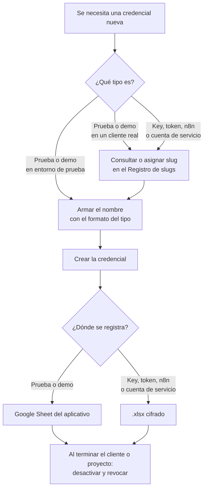

# PROTOCOLO DE NOMENCLATURA DE CREDENCIALES

*Polaria | Técnico*

| Versión | Creado por | Aprobado por | Fecha |
|---|---|---|---|
| v1.0 | Responsable Metodología | Responsable Metodología | 15/10/2026 |

## Glosario

| Término | Significado |
|---|---|
| Credencial | Todo lo que da acceso a un sistema: una cuenta con correo y contraseña, una API key, un token, una credencial guardada en n8n o una cuenta de servicio. |
| Cuenta de servicio | Un usuario técnico que usa un sistema para conectarse a otro. No lo usa una persona. |
| Slug | El nombre corto, fijo y en minúsculas de un aplicativo o de un cliente (ej. `aguacates`, `mateosupport`). Se asigna una vez y se usa igual en todas partes. |
| Dominio del aplicativo | El dominio bajo el que corre el aplicativo (ej. `nara.com`). Si el aplicativo no tiene dominio propio, se usa `polaria.tech`. |
| Registro de slugs | Google Sheet "Registro de slugs" en la carpeta de credenciales de Drive. Lista todos los slugs de aplicativos y clientes ya asignados. |
| Ambiente | Dónde corre la credencial: `produccion` (datos reales), `prueba` (datos desechables) o `demo` (se muestra a terceros, datos estables y nunca reales). Las copias DEV de n8n usan `prueba`. |
| Variable de entorno | Un valor que el código lee de la plataforma donde corre (ej. Vercel, Railway) en vez de tenerlo escrito dentro del código. |

## 1. Contexto

Aplica cada vez que alguien crea una credencial en cualquier aplicativo de Polaria o de un cliente: una cuenta de prueba o de demo, una API key, un token, una credencial de n8n o una cuenta de servicio. No aplica a las cuentas de personas reales (del equipo de Polaria o del cliente): cada persona usa el correo que ella misma proporciona y este protocolo no le pone nombre. Lo usan quien desarrolla, el Responsable Técnico, quien muestra demos a clientes o prospectos, y las IAs que crean credenciales. Existe porque hoy cada quien nombra las credenciales a su manera: no se distingue a simple vista qué es de prueba y qué es real, en n8n hay credenciales como "Supabase account 2" que se pueden conectar por error a producción, el mismo cliente aparece con nombres distintos en cada herramienta y nadie sabe qué cuentas existen ni dónde están sus contraseñas.

## 2. Objetivo

Que cualquier persona, técnica o no, sepa al leer el nombre de una credencial a qué aplicativo, cliente y ambiente pertenece, y dónde está guardada.

## 3. Cómo funciona (Pasos)

Lo aplica quien crea la credencial. Si la crea una IA, la skill `nomenclatura-credenciales-polaria` arma el nombre y recuerda dónde registrarla; se instala en cada repo de código desde `polaria-agent-plugins`.

**Paso 1 — Identificar el tipo.** Quien crea la credencial decide cuál de estos tres tipos es:

| Tipo | Formato | Ejemplo |
|---|---|---|
| Cuenta de prueba o de demo dentro de un cliente real | `[prueba\|demo].[rol][N][.cliente]@[dominio-del-aplicativo]` (N y cliente solo cuando aplican, ver Paso 3) | `prueba.operador.aguacates@polaria.tech` |
| Cuenta de prueba o de demo en un entorno de prueba (el cliente, la empresa y la cuenta también son de prueba) | `[prueba\|demo].[rol][N]@[dominio-del-aplicativo]` | `prueba.operador@polaria.tech` |
| API key, token, credencial de n8n o cuenta de servicio | `[aplicativo]-[servicio]-[ambiente]-[cliente]` | `mateosupport-postgres-produccion-polaria` |

**Paso 2 — Consultar el slug.** Si el nombre lleva aplicativo o cliente, quien crea la credencial busca su slug en el Registro de slugs. Si no existe, lo asigna con la regla de la sección 4 y lo agrega al registro antes de seguir.

**Paso 3 — Armar el nombre.** Quien crea la credencial arma el nombre con el formato del Paso 1 y con estas reglas de cada segmento:

- **Prueba o demo:** el rol se escribe tal como existe en el aplicativo, sin abreviar. Si hay varios del mismo rol, se numeran desde el segundo: `operador`, `operador2`, `operador3`. El cliente se omite si el aplicativo tiene un solo cliente (`prueba.operador@nara.com`) o si la cuenta vive en un entorno de prueba, porque ahí no hay cliente real que nombrar.
- **Key, token, n8n o cuenta de servicio:** el aplicativo va pegado, sin guion interno (`mateosupport`). El servicio es la herramienta a la que se conecta (`postgres`, `supabase`, `openai`, `whatsapp`). El ambiente va siempre y en palabra completa. El cliente va siempre; si el aplicativo es propio, se pone `polaria`, y si todo el entorno es de prueba, se pone `prueba` (`wms-supabase-prueba-prueba`).
- **Todos:** minúsculas, sin tildes, sin ñ y sin espacios.

**Paso 4 — Crear la credencial.** Quien la crea la da de alta en el aplicativo, en n8n o en la plataforma con el nombre exacto del Paso 3.

**Paso 5 — Registrarla.** Quien la crea la anota en el lugar que corresponde a su tipo:

| Tipo | Dónde se registra |
|---|---|
| Cuenta de prueba o de demo | En el Google Sheet de cuentas de prueba o de demo del aplicativo, en la carpeta de credenciales. Si el aplicativo todavía no tiene uno, se crea como copia de la "Plantilla registro de cuentas (prueba/demo)". |
| API key, token, credencial de n8n o cuenta de servicio | En el `.xlsx` cifrado con contraseña de la carpeta de credenciales. Solo el Responsable Metodología tiene la contraseña: quien crea la key se la entrega en persona o en una llamada, nunca por chat ni por correo, y el Responsable Metodología la anota. |

**Paso 6 — Desactivar al terminar.** Cuando un cliente o un proyecto termina, el Responsable Técnico desactiva sus cuentas de prueba y de demo, las marca como desactivadas en el Sheet del aplicativo, revoca sus keys y tokens, y le avisa al Responsable Metodología, que los marca como revocados en el `.xlsx`.

## 4. Reglas

| Regla | Por qué existe |
|---|---|
| En producción, cada persona usa su propia cuenta, con el correo que ella proporciona. Nunca se crea una cuenta de rol compartida para trabajar con datos reales. | Con una cuenta compartida no se sabe quién hizo qué, y no se le puede quitar el acceso a una sola persona cuando se va. |
| `prueba` y `demo` se escriben siempre en palabra completa, nunca abreviados (`qa`, `test`, `dm`). | Cualquier persona, aunque no sea técnica, debe entender al leer el correo que la cuenta no es real. |
| Nunca se usa un dominio ajeno ni inventado (ej. `@test.com`, `@gmail.com`), y el aplicativo nunca envía correos a cuentas de prueba o de demo. | Un dominio ajeno puede entregar el correo a una persona real. Estas cuentas no tienen buzón: los correos rebotan, y muchos rebotes dañan la reputación del remitente y pueden suspender el envío de correos de todo el aplicativo. |
| El slug de un cliente es la palabra más distintiva de su nombre (Aguacates de Puebla → `aguacates`); se agrega otra palabra solo si ya existe ese slug en el registro (Aguacates del Norte → `aguacatesnorte`). El slug de un aplicativo es su nombre completo pegado (Mateo Support → `mateosupport`). Nunca es una sigla y, una vez asignado, no cambia. | Una sigla nadie la entiende meses después. Si el slug cambia, el mismo cliente queda con dos nombres en las herramientas y se pierde el rastro de sus credenciales. |
| Toda API key, token, credencial de n8n o cuenta de servicio lleva el ambiente y el cliente en el nombre. | Sin el ambiente, la credencial de prueba y la de producción se ven iguales en n8n, y un workflow de prueba puede escribir en la base de datos real. |
| Fuera de la plataforma donde se usa (credenciales de n8n o variable de entorno), una key o token real solo se guarda en el `.xlsx` cifrado con "Cifrar con contraseña" (Archivo > Información > Proteger libro). Nunca en un Google Sheet, en un chat, en un documento ni dentro del código. "Proteger hoja" no sirve. | Una key en texto plano la ve cualquiera con acceso a la carpeta o al repo, y queda en el historial aunque se borre después. "Proteger hoja" solo impide editar celdas: el contenido se sigue leyendo. |

## 5. Excepciones

| Situación | Qué hacer |
|---|---|
| Una credencial ya existe con un nombre que no sigue este protocolo (ej. "Supabase account 2", "Cuentas prueba WMS"). | Se renombra cuando alguien la toque por otro motivo, no todas de golpe. Quien la renombra actualiza también su registro en el Sheet o en el `.xlsx`. |
| La plataforma no acepta guiones en el nombre (ej. variables de entorno de Vercel y Railway, que solo aceptan letras, números y guion bajo). | Se usa la misma regla en mayúsculas y con guion bajo: `MATEOSUPPORT_POSTGRES_PRODUCCION_POLARIA`. Si se renombra una variable de entorno que ya existe, quien la renombra actualiza en el mismo cambio el código que la lee. |

## Herramientas

Todas viven en la carpeta de credenciales del Drive de Polaria.

| Herramienta | Para qué se usa | Quién necesita acceso |
|---|---|---|
| Google Sheet "Registro de slugs" | Lista de slugs de aplicativos y clientes. Columnas: Tipo (aplicativo o cliente), Nombre, Slug, Fecha y Quién lo asignó. | Todo el equipo. |
| "Plantilla registro de cuentas (prueba/demo)" ([enlace](https://docs.google.com/spreadsheets/d/1766sKC7b51AGbbaJv0a54r-x89MsnT26DvE8lEyY_GM/edit)) | Estructura que copia cada Sheet de cuentas: datos de acceso generales (URL, empresa, cuenta, contraseña general, forma de ingreso) y una fila por cuenta con Rol, Correo, Contraseña, Empresa asignada, Nombre, accesos, Descripción y Estado (activa o desactivada). | Todo el equipo. |
| Google Sheets de cuentas de prueba y de demo, uno por aplicativo | Una copia de la plantilla por aplicativo. | Todo el equipo. |
| `.xlsx` cifrado con contraseña | Una fila por API key, token, credencial de n8n o cuenta de servicio. Columnas: Nombre, Valor, Plataforma donde se usa, Estado (activa o revocada) y Notas. | Solo el Responsable Metodología. |

## Rollback

Si al renombrar una credencial algo deja de funcionar, quien la renombró le devuelve el nombre anterior, confirma que el aplicativo o el workflow vuelve a funcionar, y anota qué falló en la Descripción del Sheet; si es una key o token, se lo avisa al Responsable Metodología para que lo anote en el `.xlsx`. En n8n, renombrar una credencial no rompe los workflows, porque la referencian por su ID y no por su nombre. Lo que sí los rompe es borrar la credencial y crear otra nueva.
